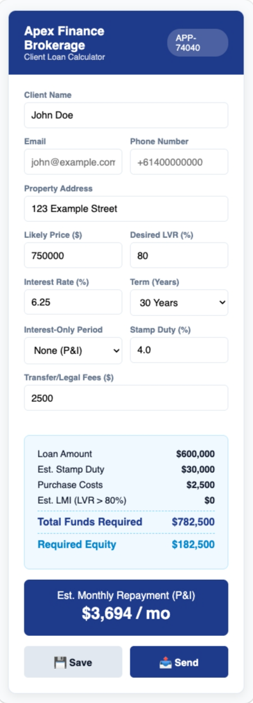
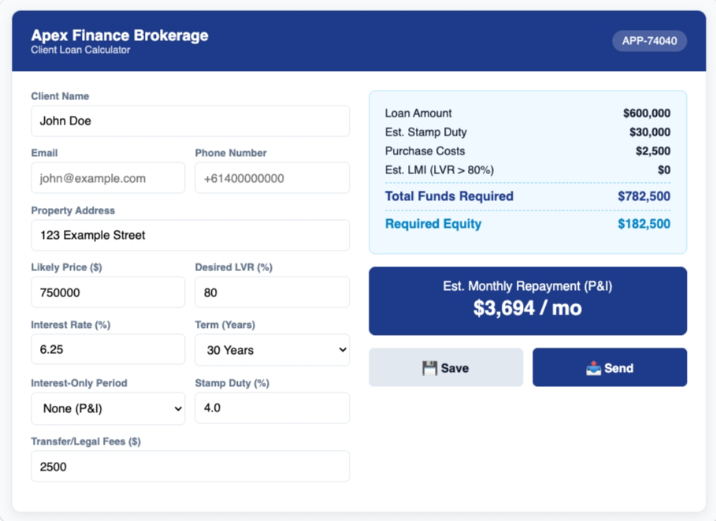
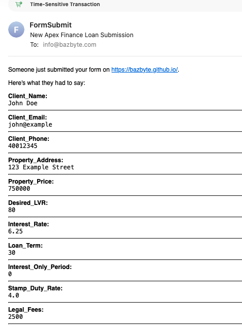

# 🏦 Apex Finance — Client Loan Calculator

A lightweight, responsive web application designed for mortgage brokers and clients to quickly calculate property loan metrics, estimated monthly repayments, required equity, and purchase costs in real time.

🚀 **Live Web App:** [https://bazbyte.github.io/airtasker/](https://bazbyte.github.io/airtasker/)

> 👈 **Click the image above to launch the live interactive app!**


[](https://bazbyte.github.io/airtasker/)              [](https://bazbyte.github.io/airtasker/).       

[](https://bazbyte.github.io/airtasker/)

---

## 📌 Project Overview

This tool provides instant financial calculations for property buyers and mortgage brokers. Users can adjust loan parameters and immediately submit client leads or application details directly via email.

### Key Features

* **Real-time Loan Calculations:** Dynamically updates loan amounts, stamp duty, transfer/legal fees, total funds required, and required equity as parameters change.
* **Monthly Repayment Estimator:** Calculates monthly principal and interest repayments based on rate and loan term (20, 25, or 30 years).
* **Lead Capture & Dispatch:** Integrated form submission powered by FormSubmit to dispatch client details directly to an email inbox.
* **Fully Responsive:** Optimized for both mobile devices and desktop screens.
* **Zero Dependencies:** Built with pure static HTML5, CSS3, and modern JavaScript—no heavy frameworks required.

---

## 🧮 Running Logic & Calculation Formulas

The web application executes all calculations locally in real-time using modern JavaScript. An event listener watches all numeric inputs (`price`, `lvr`, `rate`, `term`, `duty`, `legal`) and recalculates the output metrics on every keystroke.

### 1. Loan Amount ($P$)

$$
\text{Loan Amount} = \text{Property Price} \times \left(\frac{\text{LVR}}{100}\right)
$$


### 2. Lenders Mortgage Insurance (LMI)

Calculated automatically when $\text{LVR} > 80\%$:

* **$80\% < \text{LVR} \le 85\%$:** $\text{LMI} = \text{Loan Amount} \times 1.2\%$
* **$85\% < \text{LVR} \le 90\%$:** $\text{LMI} = \text{Loan Amount} \times 2.4\%$
* **$\text{LVR} > 90\%$:** $\text{LMI} = \text{Loan Amount} \times 4.2\%$

### 3. Total Funds Required & Required Equity

$$
\text{Total Funds Required} = \text{Property Price} + \text{Stamp Duty} + \text{Legal Fees} + \text{LMI}
$$

$$
\text{Required Equity} = \text{Total Funds Required} - \text{Loan Amount}
$$

### 4. Monthly Repayment ($M$)

* **Interest-Only Period ($M_{\text{IO}}$):**
  $$
  M_{\text{IO}} = P \times r
  $$
* **Post Interest-Only P&I Period ($M_{\text{P\&I}}$):**
  $$
  M_{\text{P\&I}} = P \cdot \frac{r(1 + r)^{n_{\text{remaining}}}}{(1 + r)^{n_{\text{remaining}}} - 1}
  $$

---

## 🛠️ Requirements & Prerequisites

### For End-Users

* Any modern web browser (Chrome, Safari, Edge, Firefox) on desktop or mobile.

### For Local Development

* **VS Code** (or any standard text editor).
* **Live Server Extension** (optional, for local testing).
* **Git** installed on your machine for version control.

---

## 📂 Repository Structure

```text
airtasker/
├── .nojekyll      # Bypasses Jekyll build processing for GitHub Pages
├── index.html     # Main static application (UI, CSS, JS, and form logic)
└── README.md      # Project documentation
```
